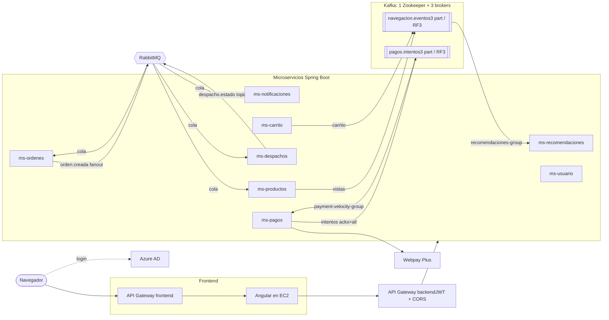
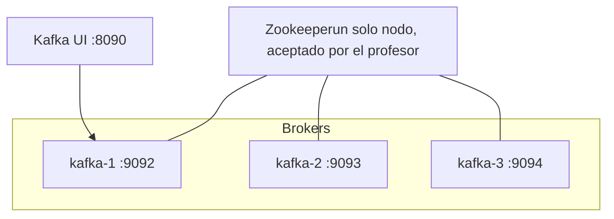

# DevGear Store: arquitectura y guion de demo

EV3 Cloud Native I (DSY1107). Frontend Angular, 8 microservicios Spring Boot, RabbitMQ para eventos transaccionales y Kafka para eventos de alto volumen.

## 1. Vista general

Dos API Gateway: uno sirve el frontend y otro protege el backend con el JWT de Azure AD y CORS hacia el origen del frontend. Cada microservicio tiene su propia base MySQL.

## 2. Por qué Kafka y RabbitMQ conviven

Una orden creada se consume una sola vez por cada servicio interesado y no se vuelve a leer: va por RabbitMQ. Los clics de navegación y los intentos de pago son muchos, se pueden reprocesar y los leen varios grupos distintos: van por Kafka, que conserva el log según la retención del tópico.

## 3. Cluster Kafka

| Tópico | Part. / réplicas | Retención | Garantías | Clave |
| --- | --- | --- | --- | --- |
| navegacion.eventos | 3 / 3 | 1 día | `acks=1`, min ISR 1. Se tolera perder algún clic. | usuarioId |
| pagos.intentos | 3 / 3 | 7 días | `acks=all`, min ISR 2. No se pierde un intento de pago. | idCliente |

Zookeeper coordina la elección de líder y la membresía de brokers. Con 3 réplicas por partición, la caída de un broker no detiene la lectura ni la escritura.

## 4. Guion de demo (8 a 9 minutos)

| Min | Qué mostrar | Indicador de la rúbrica |
| --- | --- | --- |
| 0:00 | Este diagrama. Explicar Docker Compose, Zookeeper, 3 brokers y la elección RabbitMQ vs Kafka. | Arquitectura, justificación de tópicos |
| 1:30 | Kafka UI: los 2 tópicos, 3 particiones, 3 réplicas, retención 1 día y 7 días, configuración de `acks` y min ISR. | Administración, diseño de eventos |
| 3:00 | En el catálogo, hacer clic en productos y agregar al carrito. Ver mensajes en `navegacion.eventos` y aparecer "Recomendados para ti". | Productor/consumidor, caso de uso, reacción en tiempo real |
| 4:30 | Consumer groups: `recomendaciones-group` con 3 miembros y lag 0. Apagar el servicio, generar clics, mostrar lag creciendo, encender y ver lag volver a 0. | Monitoreo de offsets y lag |
| 6:00 | Pago con Webpay (VISA 4051 8856 0044 6623). Hacer 3 intentos en 10 s: bloqueo antifraude de 30 min. Mostrarlo en "Kafka en vivo" y desbloquear. | Caso de uso, reacción en tiempo real |
| 7:30 | Detener solo `kafka-2`: el Isr baja a 2 y la app sigue funcionando. Levantarlo y ver Isr 3. | Tolerancia a fallas, disponibilidad |

Detén un solo broker. Con dos caídos, `pagos.intentos` deja de aceptar escrituras (min ISR 2); ms-pagos sigue funcionando porque ignora la falla de Kafka, pero se pierde el antifraude.